# Descripción del Caso: Generación de Factura Electrónica XML a partir de Invoice XSD 2.1

## 1. Contexto y Problema de Negocio

En la primera parte del curso se utilizó el **módulo de Ventas de Odoo** desde sus **binarios precompilados**. Desde la perspectiva de un usuario final, descargar binarios e instalarlos permite operar el flujo comercial básico (cotización, confirmación de orden de venta y emisión de factura interna en pantalla o PDF).

Sin embargo, desde la perspectiva de un **programador y arquitecto de software**, trabajar únicamente con binarios limita la extensibilidad e interoperabilidad del sistema. Cuando una empresa necesita intercambiar documentos electrónicos con otros sistemas (ERPs externos, portales B2B o plataformas de facturación electrónica), un PDF o una tabla interna de base de datos no es suficiente: se requiere un **documento estructurado bajo un estándar internacional**, en este caso **OASIS UBL 2.1 (`UBL-Invoice-2.1.xsd`)**.

El enfoque de desarrollo basado en **código fuente (Git)** permite construir un componente desacoplado en Python que reciba los datos de una venta/factura confirmada desde el módulo de Ventas de Odoo y genere un archivo **XML UBL 2.1** garantizado contra el esquema oficial XSD 2.1.

---

## 2. Caso de Uso Principal

**Caso:** *Emisión e interoperabilidad de factura electrónica desde un pedido de venta confirmado en Odoo.*

1. En **Odoo Ventas**, el vendedor confirma un pedido de venta (por ejemplo, `SO-2026-0042`) para un cliente, con líneas de productos, cantidades, precios unitarios e impuestos.
2. El sistema exporta o envía los datos estructurados de la venta/factura hacia nuestro servicio generador en Python (`GenerateInvoiceXmlUseCase`).
3. El módulo de aplicación transforma el payload de Odoo hacia un **Modelo de Dominio puro (`Invoice`)** que valida invariantes de negocio y realiza cálculos monetarios exactos usando `Decimal` (evitando errores de precisión de punto flotante `float`).
4. La capa de infraestructura traduce el modelo de dominio hacia las **clases tipadas generadas directamente desde `UBL-Invoice-2.1.xsd`** mediante `xsdata`.
5. El serializador produce el XML UTF-8 con los namespaces oficiales de OASIS UBL 2.1 y, como barrera final de calidad, el validador verifica que el documento cumpla al 100% con el esquema `UBL-Invoice-2.1.xsd` antes de entregarlo.

---

## 3. Decisiones de Arquitectura

### 3.1. Enfoque *Schema-First* (Generación desde XSD 2.1) frente a XML manual
Concatenar cadenas o construir nodos XML manualmente con `ElementTree` introduce fallos difíciles de mantener:
- **Orden estricto (`<xsd:sequence>`):** UBL 2.1 exige un orden exacto para los subelementos; invertir dos etiquetas invalida todo el documento.
- **Namespaces complejos:** UBL 2.1 combina al menos tres espacios de nombres (`Invoice-2`, `cac` para agregados comunes y `cbc` para componentes básicos).

Por ello se adoptó **Data Binding con `xsdata`**: las clases Python en `src/invoice_xml/infrastructure/ubl_models/` se compilan directamente desde `schemas/ubl-2.1/maindoc/UBL-Invoice-2.1.xsd` y sus dependencias `common/`.

### 3.2. Arquitectura en Capas (Separación Dominio / Infraestructura)

```mermaid
flowchart LR
    ODOO["Payload Odoo Ventas (JSON/Dict)"] --> APP["Capa Aplicación (GenerateInvoiceXmlUseCase)"]
    APP --> DOM["Dominio Puro (Invoice, InvoiceLine, Party)"]
    DOM --> MAP["Mapper UBL 2.1"]
    MAP --> XSD_MODELS["Modelos Generados desde XSD 2.1 (xsdata)"]
    XSD_MODELS --> SER["XmlSerializer UTF-8"]
    SER --> VAL["XsdValidator (UBL-Invoice-2.1.xsd)"]
    VAL --> XML["Factura XML UBL 2.1 Válida"]
```

- **Dominio (`src/invoice_xml/domain/`):** No importa ni `xsdata`, ni `lxml`, ni librerías de Odoo. Define reglas de negocio (moneda ISO 4217, código de país ISO 3166-1 alpha-2, cantidades mayores a cero, redondeo financiero `ROUND_HALF_UP`).
- **Aplicación (`src/invoice_xml/application/`):** Orquesta el caso de uso principal y provee un adaptador (`odoo_adapter.py`) que convierte estructuras típicas de un pedido/factura de Odoo Ventas al dominio.
- **Infraestructura (`src/invoice_xml/infrastructure/`):** Contiene los esquemas locales (`schemas/ubl-2.1/`), los modelos compilados desde el XSD, el mapper, el serializador y el validador XSD.

### 3.3. Reproducibilidad vía Git (`git clone`)
Todos los esquemas XSD oficiales necesarios (`maindoc` y `common`) se versionan dentro del repositorio en `schemas/ubl-2.1/`, utilizando rutas relativas (`pathlib.Path`) y dependencias declaradas en `pyproject.toml` y `requirements.txt`. Cualquier evaluador o desarrollador puede clonar el repositorio y ejecutar las pruebas unitarias sin conexión a internet ni configuraciones manuales.

